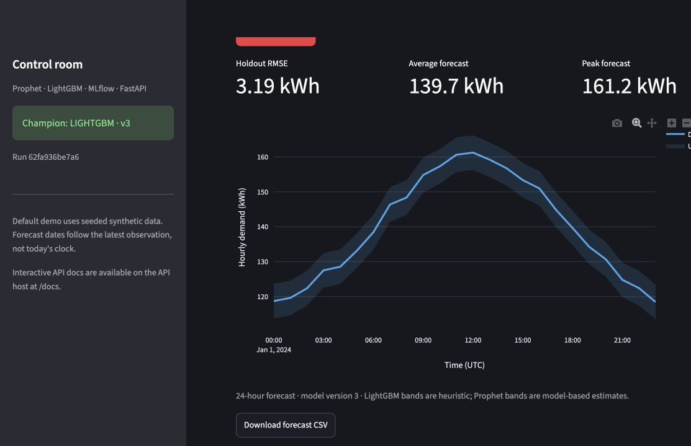
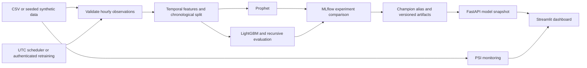

# ForecastOps ⚡

**An end-to-end energy forecasting system that trains competing models, tracks experiments, promotes a champion, and serves monitored forecasts through an API and dashboard.**

Built to demonstrate Python engineering, time-series modeling, experiment tracking, API design, testing and reproducible deployment. The default data is explicitly synthetic, so anyone can run the complete project without credentials or downloads.



## Models, not LLMs

ForecastOps uses **LightGBM** (gradient-boosted decision trees) and **Prophet** (trend and seasonal forecasting). Both train locally on hourly demand. No large language model, OpenAI API key, or paid inference service is used.

## Run the demo

With Docker Compose installed:

```sh
cp .env.example .env
# Optional: set FORECASTOPS_API_KEY in .env to enable manual retraining.
docker compose up --build
```

The initial run trains both models before starting serving. Open the [dashboard](http://localhost:8501), [interactive API docs](http://localhost:8000/docs), or [readiness endpoint](http://localhost:8000/ready). The persistent `forecastops` volume holds data, models and experiment history.

### Local Python setup

Use Python 3.11. macOS users need `brew install libomp` for LightGBM; Debian/Ubuntu users need `libgomp1`.

```sh
python3.11 -m venv .venv
source .venv/bin/activate
python -m pip install -r requirements.lock
python -m pip install --no-deps --no-build-isolation -e .
cp .env.example .env
python -m scripts.train
uvicorn app.main:app --host 127.0.0.1 --port 8000
```

In a second terminal, activate the environment and run:

```sh
streamlit run frontend/streamlit_app.py
```

Optional experiment browser: `mlflow ui --backend-store-uri sqlite:///mlflow.db --port 5000` (keep it local).

## What the project demonstrates

- **Reproducible ingestion:** seeded hourly demand generator or your own CSV; strict timestamp, missing-value and numeric validation.
- **Temporal feature engineering:** lagged demand, shifted rolling statistics and cyclic calendar features.
- **Fair candidate comparison:** Prophet and LightGBM use the same chronological holdout. LightGBM early stopping uses a separate inner validation window; recursive holdout inference cannot read future actual demand.
- **Tracked model lifecycle:** parameters, metrics and model artifacts in MLflow; the best candidate receives the `champion` alias. Serving loads immutable versions and returns matching model metadata.
- **Operational serving:** bounded 1–168 hour forecasts, liveness and readiness endpoints, protected retraining, serialized training jobs, UTC scheduling and visible failures.
- **Monitoring and inspection:** PSI with explicit tail bins, model history, interactive forecast bands and downloadable predictions.
- **Engineering checks:** unit, API and real MLflow integration tests; lint and formatting checks in GitHub Actions; non-root container and persistent storage.

## Architecture



## Evaluation

Run `python -m eval.run_eval` to train, compare and register the winner using the same pipeline as production. Every successful run writes a machine-readable report to `data/reports/latest.json`. The holdout is the final four weeks; the preceding data is the training set. MAE and RMSE use kWh; MAPE is a percentage.

Results from the verified local run are recorded below after execution. Synthetic data measures reproducibility of the demo, not performance on real customers.

| Model | MAE (kWh) | RMSE (kWh) | MAPE |
|---|---:|---:|---:|
| lightgbm | 2.529 | 3.188 | 1.89% |
| prophet | 3.004 | 3.794 | 2.26% |
| Weekly seasonal naive | 4.810 | 5.984 | 3.57% |

Measured on 17,520 synthetic hourly observations (seed 42), with 672 holdout hours. See [benchmark metadata](docs/benchmark.json). Run-to-run differences may occur across library and operating-system versions.

## API

| Method | Route | Purpose |
|---|---|---|
| GET | `/health` | Process liveness and registry status |
| GET | `/ready` | 200 when the model loads and history exists; otherwise 503 |
| GET | `/forecast?hours=24` | Forecast and immutable model version metadata |
| GET | `/model/info` | Current champion metadata |
| GET | `/model/versions` | Registered version history |
| GET | `/drift` | Adjacent four-week PSI comparison |
| POST | `/retrain` | Synchronous training; requires `X-API-Key` |
| GET | `/scheduler/status` | Scheduler, training and last failure status |

```sh
curl 'http://localhost:8000/forecast?hours=24'
curl -X POST http://localhost:8000/retrain -H "X-API-Key: $FORECASTOPS_API_KEY"
```

Without a configured secret, retraining returns 503. Invalid keys return 401; overlapping training returns 409. Read endpoints are intended for a trusted demo environment.

## Development

```sh
ruff check .
ruff format --check .
python -m pytest --cov=app --cov-report=term-missing
```

The integration test trains real models against an isolated SQLite registry, promotes **both** flavors and calls the API to verify serving. It does not mock model training or loading. `pytest -m 'not integration'` runs the faster checks.

| Location | Responsibility |
|---|---|
| `app/ingestion/` | Data generation, schema and quality validation |
| `app/features/` | Lag, rolling and calendar features |
| `app/training/` | Candidate training, tracking and champion promotion |
| `app/serving/` | Versioned model snapshots and recursive inference |
| `app/monitoring/` | Population and prediction-error drift |
| `app/scheduling/` | Single-process job coordination and UTC schedule |
| `frontend/` | Streamlit dashboard |
| `tests/` | Unit, API and integration tests |
| `docs/OPERATIONS.md` | Deployment, data contract, backup and rollback |

## Free hosted demo

The Render variant bundles trained synthetic-data models during the Docker build and serves a public dashboard with an internal API. Public retraining is disabled. See [Render setup](docs/RENDER.md).

## Deployment scope and limitations

This is a complete single-node portfolio system with production-oriented safeguards. Public or high-availability deployment requires additional infrastructure: TLS, access control, request limits, an external training worker and shared model storage. The scheduler supports one API worker. Candidate selection chooses the best model in the current run and does not guarantee improvement over the incumbent. Synthetic history is static; forecasts follow its final timestamp.

LightGBM uncertainty bands are heuristic rather than calibrated 95% intervals. Real-world model selection needs rolling-origin evaluation on real energy data. See [operations and deployment notes](docs/OPERATIONS.md) for details.
